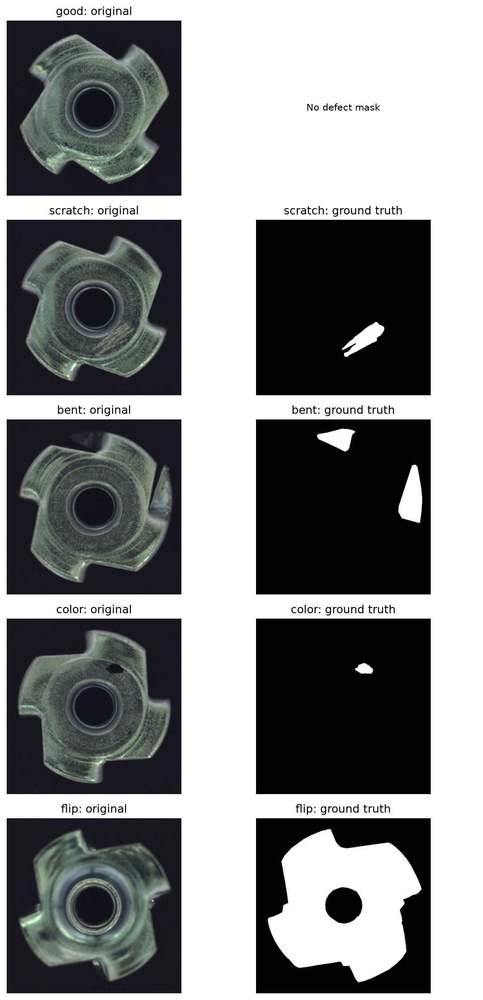
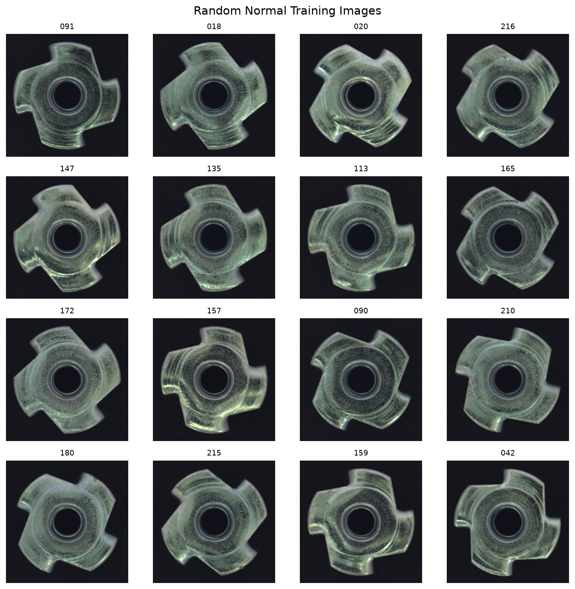
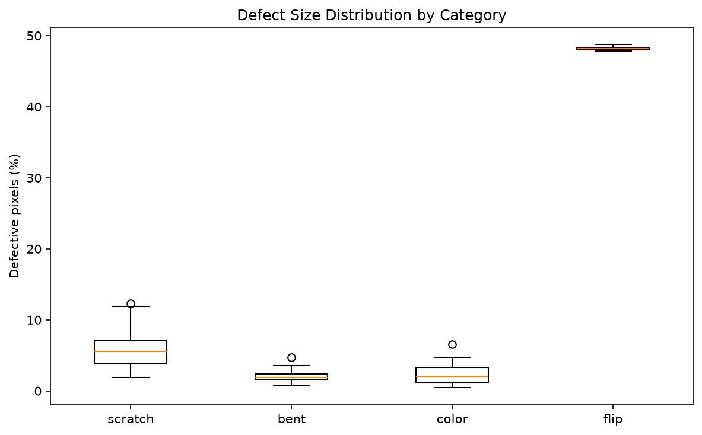
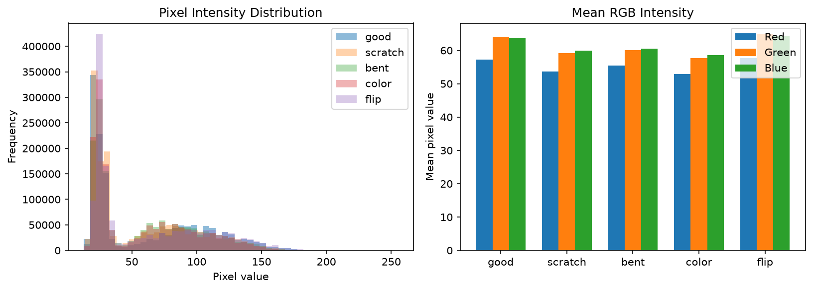

# InspectAI — Industrial Visual Anomaly Detection

**InspectAI** არის Computer Vision-ის ამოცანაზე დაფუძნებული პროექტი, რომლის მიზანია სამრეწველო დეტალების გამოსახულებებში დეფექტების აღმოჩენა და მათი მდებარეობის განსაზღვრა. პროექტში შედარებულია ოთხი მიდგომა, ჩატარებულია მონაცემთა ანალიზი, ჰიპერპარამეტრების კვლევა და feature-layer ablation study. საუკეთესო მოდელისთვის შექმნილია **Streamlit** დემო.

**საუკეთესო მოდელი: PatchCore (ResNet18, `layer2 + layer3`, 800-ელემენტიანი memory bank).**

| ოფიციალური MVTec AD ტესტის მეტრიკა | PatchCore |
|---|---:|
| Image AUROC | **0.9834** |
| Image Average Precision | **0.9962** |
| Pixel AUROC | **0.9749** |
| Pixel Average Precision | **0.8359** |

> **შენიშვნა:** ზემოთ წარმოდგენილი მეტრიკები მიღებულია `metal_nut` კატეგორიის რეალურ ტესტურ მონაცემებზე. ქვემოთ აღწერილი tuning/ablation ექსპერიმენტები შესრულდა *სინთეზურ ვალიდაციის ანომალიებზე*; ეს ორი ტიპის შედეგი უშუალოდ შედარებადი არ არის.

## 1. პრობლემა და მიზანი

საწარმოო ხარისხის კონტროლში ხშირად საჭიროა დეფექტების აღმოჩენა მაშინაც კი, როდესაც დეფექტური მაგალითები ცოტაა ან მათი სახეობები წინასწარ ცნობილი არ არის. InspectAI სწავლობს **ნორმალური დეტალების ვიზუალურ წარმოდგენებს** და აფასებს, რამდენად განსხვავდება ახალი გამოსახულება მათგან.

პროექტის ორი ძირითადი ამოცანაა:

- **Anomaly detection:** გამოსახულებისთვის ანომალიის ქულის გამოთვლა.
- **Anomaly localization:** სითბური რუკის (heatmap) შექმნა, რომელიც სავარაუდო დეფექტურ რეგიონებს აჩვენებს.

## 2. მონაცემთა ნაკრები

გამოყენებულია [MVTec AD](https://www.kaggle.com/datasets/ipythonx/mvtec-ad/data) მონაცემთა ნაკრების **`metal_nut`** კატეგორია.

| მონაცემები | რაოდენობა |
|---|---:|
| ნორმალური სასწავლო გამოსახულებები | 220 |
| ნორმალური ტესტური გამოსახულებები | 22 |
| დეფექტური ტესტური გამოსახულებები | 93 |
| **სულ** | **335** |

დეფექტური გამოსახულებები ოთხ კატეგორიად იყოფა: `scratch` (23), `bent` (25), `color` (22) და `flip` (23). საწყისი გამოსახულებების ზომაა **700 × 700**, ხოლო დეფექტურ მაგალითებს ახლავს პიქსელური ground-truth ნიღბები.

### მონაცემთა მაგალითები

ქვემოთ წარმოდგენილია ნორმალური და დეფექტური მეტალის დეტალები და შესაბამისი ნიღბების მაგალითები.



### ნორმალური გამოსახულებების ვარიაცია

ნორმალური მაგალითების ვიზუალური განსხვავებების შესწავლა მნიშვნელოვანია, რადგან მოდელმა უნდა განასხვაოს დასაშვები ვარიაცია რეალური ანომალიისგან.



### დეფექტების ზომის განაწილება

პიქსელური ground-truth ნიღბებით შესწავლილია სხვადასხვა კატეგორიის დეფექტების ფართობები.



### პიქსელებისა და RGB განაწილება



### მონაცემთა მთლიანობის შემოწმება

- შემოწმდა გამოსახულებებისა და ground-truth ნიღბების შესაბამისობა.
- დეკოდირებული პიქსელების SHA-256 ჰეშებით **ზუსტი train/test დუპლიკატები არ აღმოჩნდა**.
- pHash-ით მცირე მანძილზე მოინიშნა **4 პოტენციურად მსგავსი წყვილი**; ეს ავტომატურად არ ნიშნავს დადასტურებულ დუბლიკატს ან leakage-ს.

## 3. მოდელები

### 3.1. ResNet18 + 1-NN — Baseline

ImageNet-ზე წინასწარ გაწვრთნილი ResNet18-ით მიიღება **გლობალური მახასიათებლების ვექტორები**. ტესტური გამოსახულების ანომალიის ქულა გამოითვლება ნორმალური სასწავლო გამოსახულებების ვექტორებამდე უმცირესი ევკლიდური მანძილით.

ეს მარტივი baseline გამოიყენება იმის შესაფასებლად, რამდენად მნიშვნელოვანი შეიძლება იყოს სივრცული, ლოკალური მახასიათებლები.

### 3.2. PatchCore — საუკეთესო მოდელი

PatchCore-ის გამარტივებული იმპლემენტაცია იყენებს pretrained ResNet18-ის **`layer2` და `layer3`** შუალედურ მახასიათებლებს. სხვადასხვა სივრცულ გარჩევადობაზე მიღებული მახასიათებლები ერთიანდება patch-დონის წარმოდგენად.

1. ნორმალური გამოსახულებებიდან ამოიღება ლოკალური CNN მახასიათებლები.
2. მიახლოებითი coreset sampling-ით შეირჩევა წარმომადგენლობითი patch-ები.
3. ტესტური patch-ებისთვის გამოითვლება უახლოეს ნორმალურ მახასიათებლამდე ევკლიდური მანძილი.
4. მანძილებით იქმნება ანომალიის რუკა, ხოლო **მაქსიმალური patch-მანძილი** გამოიყენება image-level ქულად.

| პარამეტრი | მნიშვნელობა |
|---|---|
| Backbone | ImageNet-pretrained ResNet18 |
| Feature layers | `layer2 + layer3` |
| Input size | 256 × 256 |
| Memory bank | 800 patch |
| Distance | Euclidean |
| Image-level score | Maximum patch anomaly distance |

მოდელი არ არის original PatchCore-ის სრული გამეორება; ის წარმოადგენს პროექტის ფარგლებში განხორციელებულ გამარტივებულ ვარიანტს.

### 3.3. Convolutional Autoencoder

ნულიდან გაწვრთნილი კონვოლუციური encoder–decoder ცდილობს ნორმალური სურათების აღდგენას. ანომალიის შეფასება ეფუძნება ორიგინალსა და რეკონსტრუქციას შორის განსხვავებას. გამოიყენება **MSE reconstruction loss**.

### 3.4. Residual Convolutional Autoencoder

იგივე რეკონსტრუქციული იდეა მაგრამ დამატებულია სკიპ ქონექშენები. ეს არქიტექტურა შეიქმნა იმის შესამოწმებლად, გააუმჯობესებდა თუ არა უფრო ძლიერი რეკონსტრუქცია ანომალიების აღმოჩენას.

## 4. შედეგები — რეალური ტესტური მონაცემები

| მოდელი | Image AUROC | Image AP | Pixel AUROC | Pixel AP |
|---|---:|---:|---:|---:|
| ResNet18 + 1-NN | 0.8109 | 0.9496 | — | — |
| **PatchCore** | **0.9834** | **0.9962** | **0.9749** | **0.8359** |
| Convolutional Autoencoder | 0.4663 | 0.7660 | 0.7923 | 0.2793 |
| Residual Autoencoder | 0.4027 | 0.7346 | 0.7620 | 0.2306 |

**PatchCore** საუკეთესოა როგორც image-level detection-ში, ისე pixel-level localization-ში. Pixel-level მეტრიკები შეფასებულია **128 × 128** გარჩევადობაზე.

Autoencoder-ის საუკეთესო validation reconstruction MSE იყო **0.001507**, ხოლო Residual Autoencoder-ის — **0.001098**. მიუხედავად უკეთესი რეკონსტრუქციისა, Residual Autoencoder-ის anomaly detection მეტრიკები გაუარესდა. ეს აჩვენებს, რომ **დაბალი reconstruction loss თავისთავად არ ნიშნავს კარგ anomaly detection-ს**.

## 5. PatchCore-ის ექსპერიმენტები

ექსპერიმენტები შესრულდა ნორმალური სატრენინგო მონაცემების **176/44 train/validation** გაყოფით. ვალიდაციის ნორმალურ გამოსახულებებზე ხელოვნურად შეიქმნა ვიზუალური დეფექტები. ეს მეტრიკები გამოყოფილია ოფიციალური ტესტური შედეგებისგან.

### 5.1. Memory bank / coreset ზომის კვლევა

| Coreset size | Synthetic Image AUROC | Synthetic Image AP | Synthetic Pixel AUROC | Synthetic Pixel AP |
|---|---:|---:|---:|---:|
| 400 | 0.9868 | 0.9945 | 0.9969 | 0.8348 |
| **800** | **0.9951** | **0.9977** | **0.9976** | **0.8382** |
| 1600 | 0.9954 | 0.9978 | 0.9977 | 0.8403 |

1600 patch-მა მცირედით უკეთესი შედეგი აჩვენა, თუმცა **800** შეირჩა ხარისხსა და memory-bank-ის ზომას შორის პრაქტიკული კომპრომისის გამო.

### 5.2. Feature-layer ablation

ყველა კონფიგურაციაში გამოყენებულია 800 patch-იანი ბანკი და 256 × 256 input.

| ფენები | Synthetic Image AUROC | Synthetic Image AP | Synthetic Pixel AUROC | Synthetic Pixel AP |
|---|---:|---:|---:|---:|
| `layer2` | 0.9921 | 0.9963 | 0.9969 | 0.7517 |
| `layer3` | 0.9600 | 0.9817 | 0.9945 | 0.7940 |
| **`layer2 + layer3`** | **0.9951** | **0.9977** | **0.9976** | **0.8382** |

შერწყმულმა მახასიათებლებმა საუკეთესო საერთო შედეგი აჩვენა. მაგალითად, `layer2`-თან შედარებით pixel AP გაიზარდა **0.7517-დან 0.8382-მდე**. ეს ადასტურებს ფენების კომბინაციის სარგებლიანობას **ამ სინთეზურ ვალიდაციაზე**, თუმცა რეალურ დეფექტებზე იგივე გაუმჯობესება გარანტირებული არ არის.

## 6. Streamlit დემო

აპლიკაცია იღებს მომხმარებლის მიერ ატვირთულ მეტალის დეტალის გამოსახულებას და აჩვენებს:

- ორიგინალ გამოსახულებას;
- **raw anomaly score**-ს;
- anomaly heatmap-ს;
- heatmap-ის overlay-ს ორიგინალზე;
- ინფერენსის დროს.

აპლიკაცია იყენებს `models/patchcore_final_bank.pt` ფაილს და იმავე PatchCore feature configuration-ს, რომელიც ექსპერიმენტებში იყო შერჩეული.

> **ინტერპრეტაცია:** anomaly score არ არის დეფექტის ალბათობა. დამოუკიდებლად დაკალიბრებული decision threshold-ის გარეშე დემო არ აცხადებს ავტომატურ `normal`/`defective` კლასს. Heatmap-ის ფერები ვიზუალიზაციისთვისაა და არა კალიბრირებული ალბათობები.

## 7. პროექტის სტრუქტურა

```text
inspectAI/
├── app.py
├── assets/
│   ├── dataset_examples.png
│   ├── defect_distribution.png
│   ├── image_properties.png
│   └── normal_variation.png
├── models/
│   └── patchcore_final_bank.pt
├── notebooks/
│   ├── eda.ipynb
│   ├── baseline.ipynb
│   ├── patchcore.ipynb
│   ├── autoencoder.ipynb
│   ├── residual_autoencoder.ipynb
│   ├── error_analysis.ipynb
│   ├── patchcore_hyperparameter_tunning.ipynb
│   └── patchcore_layer_ablation.ipynb
├── results/
│   └── normal_split.json
├── src/
│   ├── __init__.py
│   └── inference.py
├── requirements.txt
├── .gitignore
├── LICENSE
└── README.md
```

`data/`, დანარჩენი model checkpoints და ლოკალური ექსპერიმენტების შედეგები `.gitignore`-ით დამალულია.

## 8. ინსტალაცია და გაშვება

### 8.1. რეპოზიტორიის კლონირება

```bash
git clone https://github.com/chkhai/inspectAI.git
cd inspectAI
```

### 8.2. ვირტუალური გარემო

```bash
python3 -m venv .venv
source .venv/bin/activate
```

Windows-ისთვის აქტივაციის ბრძანება განსხვავდება.

### 8.3. დამოკიდებულებების ინსტალაცია

```bash
python -m pip install -r requirements.txt
```

### 8.4. დემოს გაშვება

```bash
python -m streamlit run app.py
```

ლოკალურად გახსენით `http://localhost:8501`.

პირველ გაშვებაზე **ResNet18-ის pretrained weights** შეიძლება ინტერნეტიდან ჩამოიტვირთოს. PatchCore-ის საბოლოო memory bank უკვე შედის რეპოზიტორიაში.

### 8.5. მონაცემთა მომზადება ნოუთბუქებისთვის

ჩამოტვირთეთ [MVTec AD](https://www.kaggle.com/datasets/ipythonx/mvtec-ad/data) და განათავსეთ `metal_nut` შემდეგ მისამართზე:

```text
data/raw/metal_nut/
├── train/good/
├── test/
│   ├── good/
│   ├── scratch/
│   ├── bent/
│   ├── color/
│   └── flip/
└── ground_truth/
    ├── scratch/
    ├── bent/
    ├── color/
    └── flip/
```


## 9. ექსპერიმენტების თრექინგი

რეპოზიტორიაში ინახება reproducible train/validation გაყოფა: `results/normal_split.json`.
ყველა ექსპერიმენტი კი თავისი ჰიპერპარამეტრებით და ევალუაციის მეტრიკებით დალოგილია [Dagshub](https://dagshub.com/lchkh23/inspectAI) ლინკზე.

## 10. დასკვნები და შეზღუდვები

- Patch-based CNN features ბევრად ეფექტური აღმოჩნდა, ვიდრე მხოლოდ გლობალური image embeddings.
- PatchCore-ის `layer2 + layer3` კომბინაცია საუკეთესო იყო განხილულ სინთეზურ ვალიდაციის კონფიგურაციებში.
- 800 patch-იანი memory bank იძლევა კარგ ბალანსს შედეგსა და რესურსის გამოყენებას შორის.
- უკეთესი რეკონსტრუქცია ყოველთვის არ ნიშნავს უკეთეს დეფექტის გამოვლენას.
- პროექტი შეფასებულია **მხოლოდ `metal_nut` კატეგორიაზე**; სხვა ობიექტებზე ან რეალურ საწარმოო პირობებში ეფექტიანობა დამატებით კვლევას მოითხოვს.
- საწარმოო გამოყენებამდე საჭიროა დამოუკიდებელი ტესტირება, შეცვლილი განათების, კამერისა და დეტალის პოზიციის პირობებში მდგრადობის შეფასება.

## AI ინსტრუმენტების გამოყენება

პროექტზე მუშაობისას დავიხმარე ChatGPT. მისი დახმარებით ხდებოდა მოდელების არქიტექტურებისა და ალგორითმების განხილვა/ვალიდაცია, Python კოდის შემუშავება და გამართვ და readme-ს სტრუქტურის აწყობა.

AI-ის მიერ შემოთავაზებული გადაწყვეტილებები გადამოწმდა პრაქტიკული ექსპერიმენტებით. კოდი გაშვებული და დატესტილია რეალურ მონაცემებზე, მოდელების შედეგები შეფასებულია სტანდარტული მეტრიკებით (AUROC, Average Precision), ხოლო სხვადასხვა არქიტექტურისა და ჰიპერპარამეტრის ეფექტურობა შედარებულია დამოუკიდებელი ექსპერიმენტებით, მათ შორის Coreset Size-ის კვლევითა და Feature Layer Ablation Study-ით.

**AI-ის მიერ გენერირებული პასუხები არ განიხილებოდა უპირობოდ სწორად** — საბოლოო გადაწყვეტილებები მიიღებოდა მიღებული მეტრიკებისა და შედეგების ანალიზის საფუძველზე.